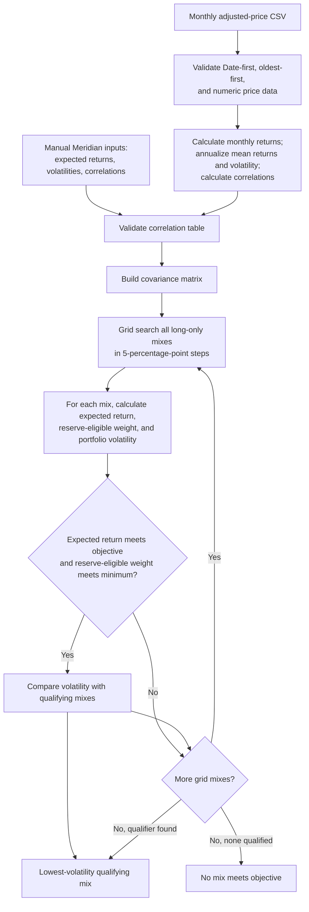

# Lab 15 Implementation

The manual Meridian-input path uses the editable annual expected returns, volatilities, and correlations directly. The monthly-price CSV path instead validates monthly adjusted prices and estimates annual returns, volatility, and correlations from monthly returns before using the same covariance and grid-search steps. Every 5-percentage-point long-only mix must meet both the objective and reserve rule; among the qualifying mixes, the one with the lowest volatility is returned.
